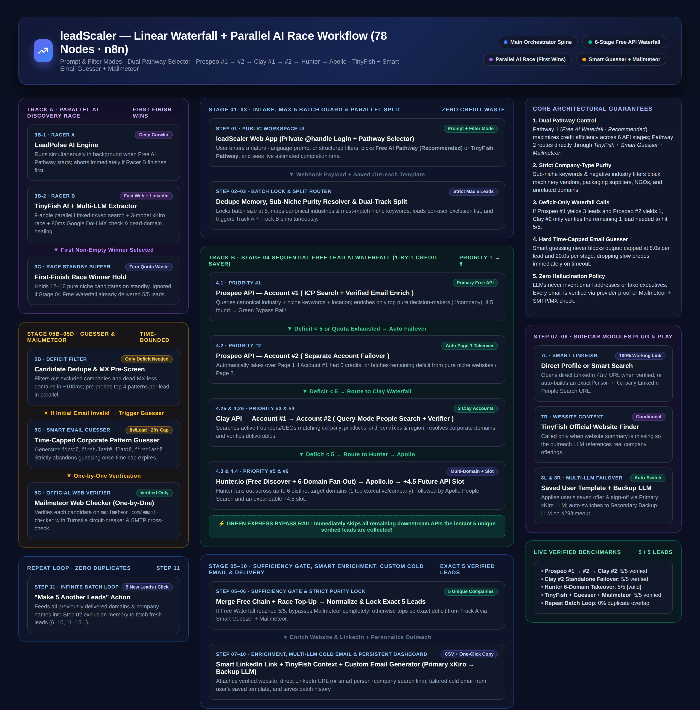
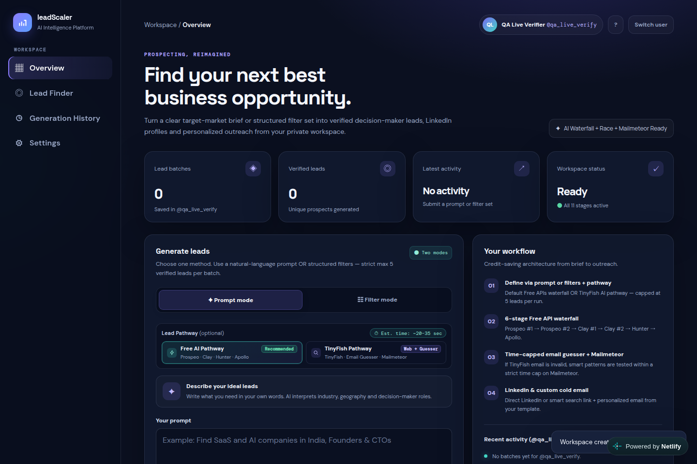
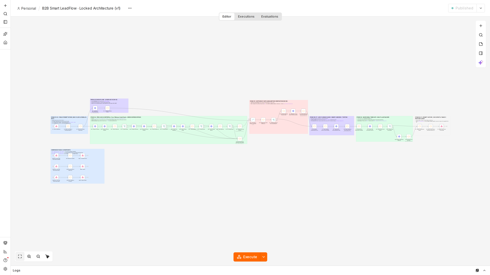

# leadScaler — AI B2B Lead Generation, Multi-Stage API Waterfall & Personalized Outreach System

<p align="center">
  
</p>

<p align="center">
  <a href="https://leadscaler.netlify.app"><strong>Live Production App (leadscaler.netlify.app)</strong></a> ·
  <a href="b2b-smart-leadflow-n8n.json"><strong>78-Node n8n Workflow JSON</strong></a> ·
  <a href="docs/ARCHITECTURE.md"><strong>Architecture Deep Dive</strong></a> ·
  <a href="docs/SETUP.md"><strong>Deployment &amp; Setup Guide</strong></a>
</p>

---

## Overview

**leadScaler** is an end-to-end B2B Decision-Maker Discovery, Multi-Stage Email Verification, and Personalized Cold Outreach platform powered by a **78-node n8n orchestration workflow (`SmartLeadFlowV1`)**, a private multi-user web workspace, and a parallel AI discovery & verification coordinator.

Every run enforces a **strict cap of 5 unique, verified decision-maker leads per batch** with persistent per-user deduplication—preventing API credit waste while guaranteeing clean company-type purity, working LinkedIn links, verified corporate email addresses, and tailored outreach emails generated from the user's saved template.

---

## Live Workspace & n8n Workflow Previews

### 1. Public Web Workspace (`Prompt Mode` + `Filter Mode` + `Dual Pathway Selector`)
<p align="center">
  
</p>

### 2. Published 78-Node n8n Workflow Canvas (`SmartLeadFlowV1`)
<p align="center">
  
</p>

---

## Key Capabilities

1. **Dual Input Modes (`Prompt Mode` & `Filter Mode`)**
   - **Prompt Mode**: Describe any target market in plain English (e.g., *"Find SaaS and AI companies in India, Founders & CTOs"* or *"Find milk and dairy companies in Delhi"*).
   - **Filter Mode**: Structured targeting across Industry, Sub-Niche, Location, Decision-Maker Role, and Company Headcount.
2. **Compact Dual Pathway Selector (with Live Estimated Completion Time)**
   - **Pathway 1 — Free AI Pathway (`Recommended`, Default)**: Routes sequentially through a credit-saving 6-stage waterfall (**Prospeo #1 → Prospeo #2 → Clay #1 → Clay #2 → Hunter.io → Apollo.io**) with an automatic parallel AI backup race if a deficit remains.
   - **Pathway 2 — TinyFish Pathway**: Routes directly through **TinyFish Multi-Angle Web/LinkedIn Discovery → Time-Bounded Smart Email Guesser → Mailmeteor One-by-One Web Checker**.
3. **6-Stage Credit-Saving Free Lead Waterfall + Green Express Bypass Rail**
   - Calls downstream providers **only for the remaining deficit** (`5 - found`).
   - The moment 5 unique verified companies are collected, the **Green Express Bypass Rail** skips every remaining downstream API to preserve free quotas.
   - Automatic Page-1 failover takeover when an upstream account has zero remaining credits.
4. **Parallel First-Finish AI Discovery Race (`LeadPulse AI` vs `TinyFish AI`)**
   - Runs concurrently in the background and selects whichever engine returns verified niche candidates first, aborting the slower branch immediately.
   - Includes `80ms` Google DNS-over-HTTPS MX validation and automatic corporate domain healing (resolving `.in`, `.co.in`, `.com`, and Clearbit matches while blocking dead or non-commercial `.org` domains).
5. **Time-Bounded Smart Email Guesser + One-by-One Mailmeteor Verification**
   - When an initial candidate email is invalid or missing, **Smart Email Guesser (`5G`)** generates corporate patterns (`first@`, `first.last@`, `flast@`, `firstlast@`) and pre-screens them concurrently.
   - Enforces a strict **`8.0s` per-lead / `20.0s` per-stage hard time cap**—immediately dropping slow probes on timeout so lead delivery is never delayed.
   - Verifies emails one by one against **`https://mailmeteor.com/email-checker`** with a Cloudflare Turnstile circuit breaker and SMTP/MX cross-check.
6. **Strict Company-Type Purity Guard**
   - Positive must-match niche terms combined with negative industry filters eliminate equipment/machinery vendors, packaging suppliers, agencies, and unrelated domains.
7. **Smart LinkedIn Resolution & Multi-LLM Cold Outreach Personalization**
   - Attaches a direct `/in/` LinkedIn profile URL when verified, or constructs a guaranteed `Person Name + Company Name` LinkedIn People Search URL.
   - Customizes the user's pre-saved **"My Email Template"** for each decision-maker via the primary LLM (`xKiro`) with automatic failover to a secondary backup LLM—never inventing fake facts or hallucinated email addresses.
8. **Private `@handle` Workspace & `"Make 5 Another Leads"` Infinite Loop**
   - Passwordless identity isolation using only Full Name + unique `@handle` (`SQLite`-backed per-user sessions, saved outreach templates, batch history, CSV export, and zero-repeat exclusion memory across batches `1–5`, `6–10`, `11–15`...).

---

## Repository Structure

```text
leadscaler/
├── b2b-smart-leadflow-n8n.json          # Import-ready 78-node n8n workflow JSON ($env.* parameterized)
├── workflows/
│   ├── b2b-smart-leadflow-n8n.json      # Canonical 78-node n8n workflow definition
│   └── build_n8n_workflow.py            # Deterministic Python generator for the n8n workflow graph
├── backend/
│   ├── smart_leadflow_web.py            # Multi-user Web API, @handle auth, purity resolver & SQLite store
│   └── mailmeteor_race_server.py        # Parallel LeadPulse/TinyFish race + Smart Email Guesser + Mailmeteor verifier
├── frontend/
│   └── index.html                       # Responsive leadScaler single-page web application
├── netlify/
│   └── functions/api.mjs                # Serverless reverse proxy with automatic primary/backup tunnel failover
├── assets/
│   ├── leadscaler-workflow-architecture.png
│   ├── n8n-workflow-canvas.png
│   └── leadscaler-dashboard.png
├── docs/
│   ├── ARCHITECTURE.md                  # Stage-by-stage technical specification (Stages 01–11)
│   └── SETUP.md                         # Self-hosting, n8n import & Netlify deployment instructions
├── tests/
│   └── test_workflow_logic.js           # Automated graph, JS syntax & secret-safety validation suite
├── .env.example                         # Environment variable template (no hardcoded secrets)
├── netlify.toml                         # Netlify build & `/api/*` routing configuration
└── package.json
```

---

## Quick Start

### 1. Clone & Validate Locally
```bash
git clone https://github.com/vaishnavizende1562-cell/leadscaler.git
cd leadscaler
npm test
```

### 2. Configure Environment Variables
Copy `.env.example` to `/opt/n8n/.env` (or your n8n environment file) and add your API keys:
```bash
cp .env.example .env
```
| Variable | Purpose |
| :--- | :--- |
| `PROSPEO_API_KEY_1` / `PROSPEO_API_KEY_2` | Stage 4.1 & 4.2 Prospeo Search + Person Enrich accounts |
| `CLAY_API_KEY_1` / `CLAY_API_KEY_2` | Stage 4.25 & 4.26 Clay Public API (`query-mode`) accounts |
| `HUNTER_API_KEY` | Stage 4.3 Hunter Free Discover + Multi-Domain Search |
| `APOLLO_API_KEY` | Stage 4.4 Apollo People Search fallback |
| `TINYFISH_KEY` | Parallel TinyFish Discovery Racer (`3B-2`) & Website Enricher (`7R`) |
| `LLM2_KEY` / `LLM2_BASE` / `LLM2_MODEL` | Primary LLM (`xKiro`) for targeting & outreach personalization |
| `GEMINI_API_KEY` | Optional secondary backup LLM (`8B`) on primary timeout/429 |

### 3. Import the 78-Node Workflow into n8n
1. Open your n8n instance (v1.x or v2.x) with environment variable access enabled (`N8N_BLOCK_ENV_ACCESS_IN_NODE=false`).
2. Import **`b2b-smart-leadflow-n8n.json`** as a standalone workflow (**`B2B Smart LeadFlow · Locked Architecture (v1)`**) and publish/activate it.

### 4. Start the Backend Services
```bash
# 1) Start the Parallel Race + Smart Email Guesser + Mailmeteor Verifier service (:8097)
python3 backend/mailmeteor_race_server.py

# 2) Start the leadScaler Web Workspace & API server (:8095)
python3 backend/smart_leadflow_web.py
```

See **[docs/SETUP.md](docs/SETUP.md)** for full `systemd`, Patchright/Chromium warmup, and Netlify zero-interstitial proxy deployment steps.

---

## Author & License

- **Developer**: [Vaishnavi Zende (`@vaishnavizende1562-cell`)](https://github.com/vaishnavizende1562-cell)
- **Live Application**: [https://leadscaler.netlify.app](https://leadscaler.netlify.app)
- **License**: [MIT License](LICENSE)
